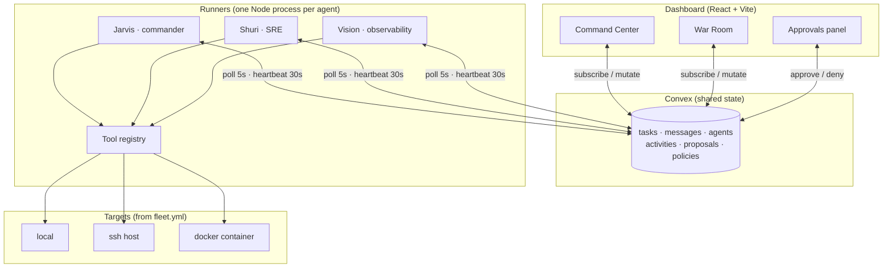
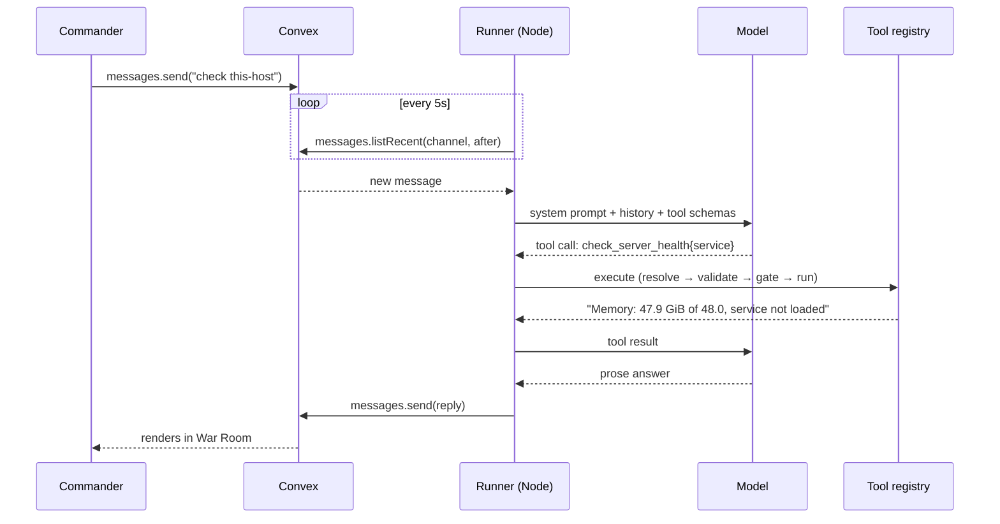

# Architecture

## The shape

Three kinds of process share one database. Convex is the only channel between them: no agent calls another directly, and no coordination state lives in a file.



This split is the whole design. The backend holds what happened; the runners hold the ability to do anything. Restarting the dashboard loses no work, and restarting a runner loses no history.

## The request path

What happens when you type a message in the War Room.



A mission takes a different first step but joins the same loop. The runner claims a task atomically, calls the brain's `work()` instead of `ask()`, and writes the result back to the card.

## Components

### Convex backend

Holds every table the system needs:

| Table | Holds |
|---|---|
| `teams` | Name, slug, mission, `allowedTools` |
| `agents` | Name, role, soul, status, heartbeat, `teamId` |
| `tasks` | Title, description, status, assignees, priority, output |
| `messages` | Channel, content, sender, timestamp |
| `activities` | The audit trail: every tool call, task transition and proposal |
| `proposals` | Gated actions with their exact arguments and lifecycle |
| `policies` | Per-team policy overrides |

Two concurrency details matter. `tasks.claim` is atomic, so two runners polling the same inbox cannot both take the same card. Proposals carry a status machine: `pending` → `approved` | `denied`, then `approved` → `executed` | `failed`. That is what stops an approved action from being silently re-run by a later poll.

### Runner

One process per soul file. `scripts/agent-runner.ts` registers the agent by name and session key, heartbeats every 30 seconds, and polls every 5. Each tick does three things in order:

1. **Tasks.** Look for work assigned to me (`assigned` or `in_progress`), or claim unowned work from the inbox.
2. **Approved proposals.** Execute anything a human has approved for me, replaying the stored arguments.
3. **Chat.** Read messages after my last timestamp, and reply to humans and direct mentions only.

That chat filter is what stops three agents from talking to each other forever. An agent sees a message if a human sent it, or if the message names the agent. Agent replies do not trigger another round.

### The brain

`scripts/openclaw_brain.ts` is a thin wrapper: a soul prompt plus a provider, wrapped around `runTurn`. It exposes `ask()` for chat and `work()` for missions, and the difference is which tools are on the table.

| Path | Tools available | Round cap |
|---|---|---|
| `ask()` chat | read tools + `create_task` | 3 |
| `work()` mission | all five | `maxToolRounds`, default 6 |

Chat deliberately cannot restart a service. A restart without a task behind it has no mission record and no approval context, so the write tools stay off in chat and the agent is expected to raise a mission instead.

### The turn loop

`scripts/agent-turn.ts` is the whole orchestration:

```
messages = [...history, userMessage]
while rounds < cap:
    res = model.chat(system, messages, toolSchemas)
    if res has no tool calls:
        return res.text                      # this is the answer
    messages.push(assistant turn with tool calls)
    for each call:
        result = registry.execute(call)
        messages.push(tool result)
    if every call this round needed approval:
        return early                         # let the human decide
# cap hit
return model.chat(tools=off, "summarise what you found and what remains")
```

Two decisions in there are worth naming. If every tool call in a round was blocked on approval, the loop stops instead of asking the model again against the same refusal. And when the cap is hit, the agent gets one final call with tools disabled, so it still reports rather than dropping the mission on the floor.

### The registry

`scripts/tools/registry.ts` runs every tool through four steps in this order, each of which can fail safely:

1. **Resolve** the tool by name. An unknown name returns the real list to the model instead of throwing.
2. **Validate** the arguments. A bad shape returns what was expected.
3. **Gate** the call. Write tools consult the policy; reads skip this entirely.
4. **Execute**, timing it and attaching audit metadata.

Tools are registered explicitly in an array instead of being discovered by scanning a directory. A plugin directory is a nice idea and a bad default: it makes the allowlist invisible to a reviewer.

### Providers

`scripts/llm/` puts the model behind one interface. Two implementations cover everything:

- `openai-compatible.ts` handles OpenAI, OpenRouter, Groq, Together, Fireworks, DeepSeek, Ollama, vLLM and LM Studio. They differ only in base URL.
- `anthropic.ts` handles Claude, whose tool-calling shape differs enough to need its own parser.

A new provider is a base URL in `KNOWN_BASE_URLS`, not a new file.

## Guardrails, and where they live

| Guardrail | Enforced in | Failure mode |
|---|---|---|
| Service allowlist | `findService()` in every tool | Refused with the real list read back |
| Host allowlist | `scanAllowlist` in `scan-network.ts` | Refused before any socket opens |
| No shell interpolation | `run()` takes an argv array | Structurally impossible |
| No silent elevation | `restart-service.ts` | Reports the refusal, does not retry |
| Policy gate | `AgentBrain.policyGate()` | Raises a proposal, does not execute |
| Bounded reads | `fetch-logs.ts` clamps to 200 lines / 256 KB | Truncated, not trusted |
| Bounded turns | `maxToolRounds` | Summary call with tools off |
| Argument validation | Each tool's `validate()` | `ToolArgumentError` to the model |

The layering is the point. The allowlist is checked inside the tool, so a policy mistake cannot widen it. The gate is checked in the registry before execute, so an approved call still cannot touch an undeclared service. There is a test for exactly that.

## What this does not do

- **No sandboxing.** Agents run as the user who started them. A tool that invokes `launchctl` invokes it with your privileges.
- **No multi-tenant isolation in the runner.** The schema carries `orgId` and the UI filters on it, but the runner does not pass org or team context through yet, so per-team policy overrides in Convex are not consulted. `fleet.yml` is the effective floor.
- **No conversational memory.** Each turn starts from the prompt plus the current message. Persistence lives in Convex tables, not in a buffer.
- **No arbitrary code execution.** By design. Adding an `exec_command` tool would make every guardrail above advisory.
